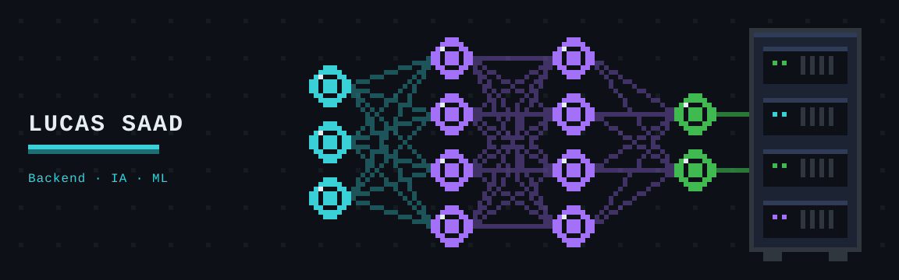
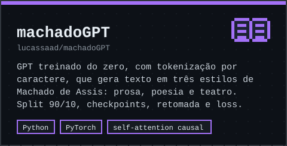
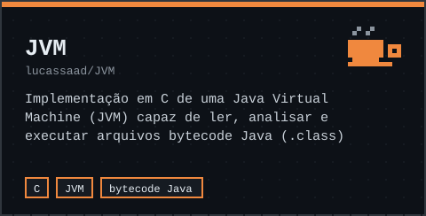

  

  <b>Estudante de Ciência da Computação @ Universidade de Brasília (UnB)</b>
   
  Engenharia de backend, agentes de IA e machine learning.

  <a href="https://www.linkedin.com/in/lucas-saadr/">LinkedIn</a>

---

<h3 align="center">Projetos em destaque</h3>

  
  

---

<h3 align="center">Sobre mim</h3>

  Gosto de construir software na interseção entre engenharia de backend e inteligência artificial.

  💻 Atualmente trabalhando com integrações de APIs e automação 
  ⚙️ Interesse em desenvolvimento backend, arquitetura de software e agentes de IA 
  🧠 Explorando machine learning, LLMs e aplicações inteligentes

---

<h3 align="center">Tech Stack</h3>

  
   
  
  

